# SEARAH — Skema Backend: ERD & Catatan Desain (v2 FINAL)

Stack: **PHP native + SQLite**. Model: **demand-driven** (pesanan → Smart Match → admin tinjau & konfirmasi → Trip).
Tarif **per rute**. Pembayaran **QRIS via Duitku (sandbox)**. Ketersediaan pakai **kalender tanggal+jam** + **mekanisme relokasi supir**. Admin **ber-scope wilayah**. Invoice & **refund** entitas sendiri.
File DDL: `backend/schema.sql` (37 tabel, tervalidasi `PRAGMA foreign_key_check` bersih).

## 1. ERD (Mermaid)

```mermaid
erDiagram
  regions  ||--o{ cities            : "mencakup"
  regions  ||--o{ drivers           : "wilayah supir"
  regions  ||--o{ user_region_scopes: "scope admin"
  users    ||--o{ user_region_scopes: "koordinator"
  cities   ||--o{ garages           : "berlokasi"
  cities   ||--o{ landmarks         : "punya"
  cities   ||--o{ routes            : "asal/tujuan"
  routes   ||--o{ fares             : "tarif/paket"

  users    ||--o| passengers        : "profil"
  users    ||--o| drivers           : "profil"
  users    ||--o{ driver_documents  : "unggah KTP/SIM"
  garages  ||--o{ drivers           : "home garage"

  partners ||--o{ vehicles          : "memiliki"
  garages  ||--o{ vehicles          : "saat ini di"
  vehicles ||--o{ vehicle_movements : "riwayat pindah"
  vehicles ||--o{ vehicle_availability : "kalender jam"
  users    ||--o{ driver_availability  : "kalender jam"
  garages  ||--o{ vehicle_availability : ""
  garages  ||--o{ driver_availability  : ""

  users    ||--o{ bookings          : "membuat"
  routes   ||--o{ bookings          : "rute"
  vehicles ||--o{ bookings          : "dipilih (D2D/Private)"
  trips    ||--o{ vehicle_availability : ""
  trips    ||--o{ driver_availability  : ""

  bookings ||--o{ trip_bookings     : ""
  trips    ||--o{ trip_bookings     : ""
  routes   ||--o{ trips             : "rute"
  vehicles ||--o{ trips             : "armada"
  users    ||--o{ trips             : "supir"
  garages  ||--o{ trips             : "garasi asal/tujuan"

  bookings ||--o{ match_suggestions : "usulan"
  trips    ||--o{ match_suggestions : "target"
  trips    ||--o{ driver_locations  : "GPS live"

  bookings ||--o{ invoices          : "tagihan"
  trips    ||--o{ invoices          : ""
  invoices ||--o{ payments          : "dibayar via"
  bookings ||--o{ payments          : ""
  payments ||--o{ payment_logs      : "callback Duitku"
  payments ||--o{ refunds           : "di-refund"
  users    ||--o{ refunds           : "memproses"
  users    ||--o{ driver_availability_requests : "supir mengajukan"
  garages  ||--o{ driver_availability_requests : "dari/ke garasi"

  bookings ||--o{ ratings           : ""
  users    ||--o{ ratings           : "dinilai (supir)"
  bookings ||--o{ cancellations     : ""
  users    ||--o{ reports           : "melapor/dilaporkan"
  regions  ||--o{ reports           : "filter wilayah"
  reports  ||--o{ account_actions   : "memicu"
  users    ||--o{ account_actions   : "dijatuhi"
  users    ||--o{ unban_requests    : "mengajukan"
  users    ||--o{ auth_tokens       : "session"
  users    ||--o{ driver_order_responses : "respons supir"
  trips    ||--o{ driver_order_responses : "diterima/ditolak"
  trips    ||--o{ driver_availability_requests : "pemicu auto"
  trips    ||--o{ trip_events      : "timeline"
  users    ||--o{ trip_events      : "aktor"
  users    ||--o{ driver_penalties : "dijatuhi"
  driver_order_responses ||--o{ driver_penalties : "pemicu"

  bookings {
    int id PK
    string code UK
    int passenger_user_id FK
    string package_type "reguler|door_to_door|private"
    int route_id FK
    int selected_vehicle_id FK "D2D/Private"
    int selected_driver_id FK "Private saja"
    string pickup_type "garasi|alamat"
    string status "menunggu_pembayaran|dibayar|menunggu_pencocokan|..."
  }
  trips {
    int id PK
    string code UK
    int vehicle_id FK
    int driver_id FK
    int capacity
    int seats_booked
    int confirmed_by FK "admin wilayah"
  }
  vehicle_availability {
    int id PK
    int vehicle_id FK
    string work_date "tanggal"
    string start_time "HH:MM"
    string end_time "HH:MM"
    string status "available|reserved|on_trip|service|off"
    int trip_id FK "terpakai utk trip ini"
  }
  driver_availability {
    int id PK
    int driver_user_id FK
    string work_date
    string start_time
    string end_time
    string status "available|reserved|on_trip|off|cuti"
    int trip_id FK
  }
  invoices {
    int id PK
    string code UK "INV-..."
    int booking_id FK
    int total
    string status "draft|issued|paid|void"
    string pdf_path
  }
  payments {
    int id PK
    int booking_id FK
    int invoice_id FK
    int amount
    string gateway "duitku"
    string merchant_code
    string duitku_ref_id
    string duitku_payment_code
    string qr_string "isi QRIS EMVCo"
    string redirect_url
    string status "pending|paid|expired|failed|refunded"
  }
  reports {
    int id PK
    string type "terhadap_driver|terhadap_penumpang"
    int subject_user_id FK
    int region_id FK " utk filter koordinator"
    string status "menunggu|diproses|selesai"
  }
  driver_availability_requests {
    int id PK
    int driver_user_id FK
    string type "relocate|isi_slot|libur|selesai_tugas"
    int from_garage_id FK
    int requested_garage_id FK "garasi/wilayah supir sekarang"
    string gps_lat "bukti lokasi"
    string status "pending|approved|rejected|cancelled"
    int reviewed_by FK "admin wilayah"
  }
  refunds {
    int id PK
    string code UK "RFD-..."
    int payment_id FK
    int amount
    string method "duitku|manual"
    string status "pending|processed|completed|failed"
  }
  driver_order_responses {
    int id PK
    int trip_id FK
    int driver_user_id FK
    string response "terima|tolak"
    string reason
  }
  settings {
    string key PK
    string value
    string description
  }
  trip_events {
    int id PK
    int trip_id FK
    string event "berangkat|tiba_jemput|berlangsung|selesai"
    int actor_user_id FK
  }
  driver_penalties {
    int id PK
    int driver_user_id FK
    string level "peringatan|sp1|sp2|sp3|suspend"
    int reject_count_at
  }
```

## 2. Alur data (demand-driven)
1. Penumpang buat `bookings` → sistem hitung tarif dari `fares` (per rute) → `invoices` (draft).
2. `payments` dibuat via **Duitku** (QRIS): simpan `qr_string`/`redirect_url`. Callback → `payment_logs` + `payments.status='paid'` + `invoices.status='paid'` → `bookings.status='dibayar'`.
3. `bookings.status='menunggu_pencocokan'` → Smart Match isi `match_suggestions` (skor + faktor).
4. Admin (sesuai **scope wilayah**) tinjau → buat/perbarui `trips` + `trip_bookings` (manifest, seat, urutan stop) → `bookings.status='dikonfirmasi'`.
5. Saat trip dikonfirmasi, slot `vehicle_availability`/`driver_availability` ditandai `on_trip` + diisi `trip_id` (cegah bentrok).
6. Live: `driver_locations` (GPS supir) → TripSync. Setelah selesai: `ratings` (recompute `drivers.rating`).

**Per paket:** Reguler = assigned mobil+supir, pickup/drop `garasi`. D2D = `selected_vehicle_id` (supir assigned), alamat sendiri. Private = `selected_vehicle_id` + `selected_driver_id` **terpisah**, prioritas rating tinggi.

**Sorting (lapisan PHP):** D2D → trip/vehicle `ORDER BY seats_booked DESC`. Private → `vehicle_availability.status='available'` join `drivers.rating DESC`. Keduanya difilter `*_availability` pada tanggal+jam & `region` admin.

## 3. Keputusan yang diterapkan (v2)
- **Ketersediaan** = tabel kalender `vehicle_availability` & `driver_availability` (tanggal + jam mulai/selesai + status + link trip).
- **Bagi hasil mitra** = **DITUNDA** (tidak ada tabel payout; `partners` tetap ada untuk kepemilikan mobil).
- **Admin per wilayah** = `regions` + `user_region_scopes`; admin tanpa scope = super admin; `reports.region_id` untuk filter; `drivers.region_id`.
- **Invoice** = entitas `invoices` (dipisah dari `bookings`/`payments`).
- **Pembayaran** = kolom khusus **Duitku** (`merchant_code`, `duitku_ref_id`, `duitku_payment_code`, `duitku_channel_code`, `duitku_result_code`, `qr_string`, `redirect_url`) + `payment_logs.signature_ok`. **Mode sandbox** dulu (`apiKey`/`merchantCode` di config PHP, bukan DB).
- **Refund** = entitas `refunds` (code `RFD-…`, `payment_id`, `amount`, `method='duitku'|'manual'`, status `pending/processed/completed/failed`). Saat `completed` → `payments.status='refunded'`.
- **Seat** = `trip_bookings.seat_no` manual (tanpa seat-map tetap per mobil).
- **Driver = "terima jadi"**: admin menyusun trip/manifest; driver hanya melihat tiket & urutan jemput→drop, lalu **terima/tolak** + update status + kirim GPS. Tidak memilih order.
- **Relokasi ketersediaan** = `driver_availability_requests` (auto saat trip selesai + verifikasi driver via GPS scan/peta manual) + `drivers.current_garage_id`/`current_region_id` (lihat §5).
- **Guard penugasan** = radius km: order hanya utk supir dalam `drivers.assign_radius_km` (haversine dari `current_garage_id`).
- **Respons supir** = `driver_order_responses` (terima/tolak + alasan, anti no-show).
- **Settings** = tabel `settings` (non-rahasia; secret Duitku tetap di config PHP).
- **Guard wilayah+radius** = posisi supir boleh titik bebas; order diambil di **garasi terdekat dalam wilayah supir** dalam `assign_radius_km` (NULL = ikut `settings.default_assign_radius_km` global).
- **Timeline** = `trip_events` (berangkat/tiba_jemput/berlangsung/tiba_drop/selesai, dst.).
- **Penalti bertingkat** = `driver_penalties` (peringatan → sp1/2/3 → suspend) + `drivers.reject_count`; threshold di `settings` (`reject_warn_threshold`, `reject_penalty_threshold`).

## 4. Asumsi yang perlu disetujui
1. **Duitku** = mode QRIS + callback (bukan redirect-only). `payments.code` dipakai sebagai `merchantCode`/orderId Duitku; verifikasi `signature` (SHA256) dilakukan di PHP, bukan DB.
2. Satu slot ketersediaan = satu rentang jam; trip yang melewati tengah malam pakai dua baris.
3. `invoices` terbit otomatis saat booking dibuat (draft) dan jadi `issued`/`paid` mengikuti pembayaran.
4. Koordinator wilayah hanya melihat/mengelola data (driver, garasi, laporan) yang `region_id`-nya sesuai scope; super admin melihat semua.

## 5. Mekanisme relokasi ketersediaan pengemudi
Masalah: setelah trip Malang→Pasuruan selesai, fisik supir ada di Pasuruan, tapi kalau basisnya
masih Malang, Smart Match/admin bisa menugaskannya order dari Malang. Solusi: **auto usulan +
verifikasi supir (GPS/peta) + approval admin + guard radius.**

**Tabel:** `driver_availability_requests` (origin `auto_trip`/`driver_manual`), `drivers.current_garage_id`/
`current_region_id`/`assign_radius_km`, `driver_availability`.
**Status:** `await_driver_verify → await_admin → approved/rejected/cancelled`.

**Alur (endpoint PHP nanti):**
1. **Auto** — saat `trips.status='selesai'` (flag `settings.relocation_auto_on_trip_complete=1`), sistem
   buat request `origin='auto_trip'`, `proposed_garage_id = trip.dest_garage_id`, status `await_driver_verify`.
   Supir juga bisa kirim manual via `POST /driver/relocation-request` (langsung `await_admin`).
2. **Verifikasi supir** (utk auto):
   - benar → `verify_method='confirm'`, `driver_confirmed=1` → `await_admin`;
   - salah → koreksi lokasi:
     - `verify_method='gps_scan'` → ambil GPS → `reported_lat/lng` → snap garasi terdekat → `requested_garage_id`;
     - `verify_method='manual_map'` → supir pilih titik di peta (Leaflet, spt prototype) → `reported_lat/lng` + `requested_garage_id`.
3. **Approval admin wilayah** `POST /admin/relocation-requests/{id}/approve` → sistem:
   - update `drivers.current_garage_id`/`current_region_id`/`location_updated_at`;
   - tandai slot lama `off`, buat slot `driver_availability` baru (`requested_garage_id`, tanggal+jam, `available`).
4. **Guard radius km** — Smart Match & assignment hanya menawarkan trip yang `origin_garage`-nya dalam
   `drivers.assign_radius_km` (haversine dari `current_garage_id`) → cegah order lintas kota.

**Catatan:** posisi supir boleh **titik bebas** (`reported_lat/lng` non-garasi); sistem snap ke **garasi terdekat dalam wilayah supir** untuk penugasan. `gps_scan`/`manual_map` hanya menentukan titik itu; `manual_map` pakai peta Leaflet (spt prototype).

## 6. Status: desain selesai → siap scaffold PHP
Semua keputusan kunci sudah terkunci. Yang tersisa hanya detail implementasi (bukan skema):
- Snap "titik bebas → garasi terdekat dalam wilayah": pakai haversine di PHP atas tabel `garages`+`cities.region_id`.
- Alur penalti: saat `driver_order_responses.response='tolak'` → `drivers.reject_count++`; lewati `reject_warn_threshold` → `driver_penalties.level='peringatan'`; lewati `reject_penalty_threshold` → `sp1/suspend` (+ `account_actions`).
- `trip_events` ditulis tiap perubahan status trip (sumber timeline & audit).
